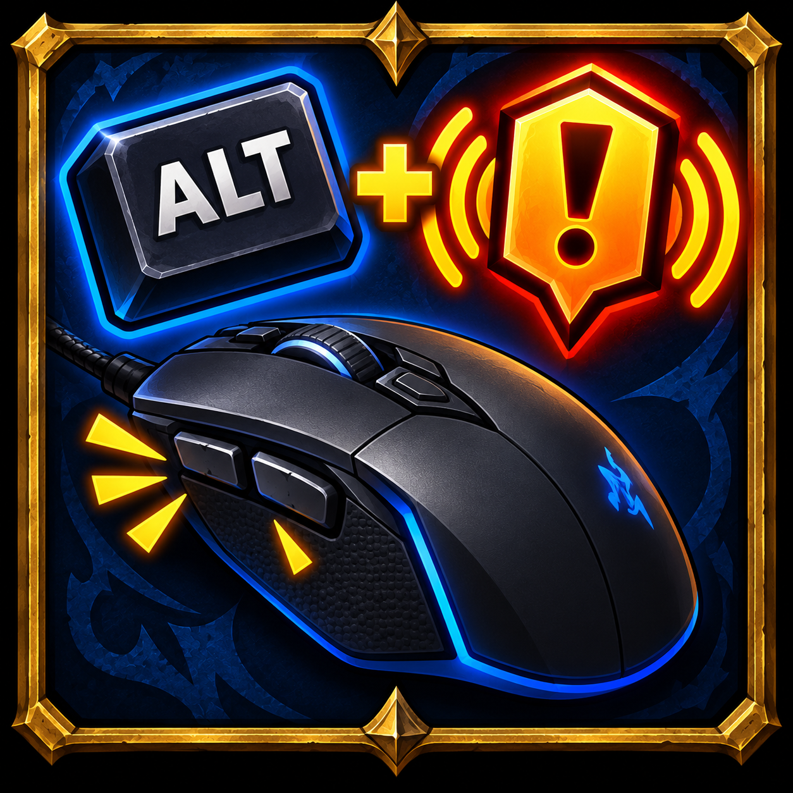

# PingAltClick

> 🤖 **Este addon ha sido íntegramente _vibe-coded_** con [Claude Code](https://claude.com/claude-code). Funciona y se ha probado en el juego, pero tenlo en cuenta.
>
> 🤖 **This addon was entirely _vibe-coded_** with [Claude Code](https://claude.com/claude-code). It works and has been tested in-game, but keep that in mind.

**[Español](#español) · [English](#english)**

---

## Español

Usa el **sistema de pings normal de Blizzard con Alt + clic izquierdo**, sin tener que llevar la mano a la tecla de ping. Hecho para **WoW: Forever**.

### Qué hace

| Dónde | Alt + clic rápido | Alt + clic mantenido |
|---|---|---|
| **Mundo** (unidades, objetos, suelo) | Ping contextual | Rueda radial (Atacar, Advertencia, En camino, Ayuda) |
| **Marcos de unidad** (tú, objetivo, foco, grupo, banda) | Ping contextual ("Salud 100%" sobre la barra de vida, unidad sobre el retrato) | Rueda radial *(fuera de combate)* |
| **Botones de acción** (Blizzard y Bartender4) | Ping de la habilidad u objeto | — |

Es el mismo sistema que la tecla de ping del juego: el resultado es idéntico al de pulsarla con el cursor en el mismo sitio. Tu tecla de ping sigue funcionando.

### Instalación

1. Descarga el addon desde CurseForge o desde las *releases* de GitHub.
2. Copia la carpeta `PingAltClick` en la carpeta `Interface/AddOns/` de tu instalación de WoW: Forever.
3. Reinicia el juego.

No necesita configuración.

### Comandos

- `/pingalt` — diagnóstico. Pon el ratón sobre un botón o marco, escribe el comando y te dice qué elemento recibe el clic, si está enganchado y cómo está configurado el sistema de pings.

### Cómo funciona y limitaciones

- La función que activa la tecla de ping (`C_Ping.TogglePingListener`) está restringida, así que el addon asigna la acción de ping (`TOGGLEPINGLISTENER`) a `ALT-BUTTON1` con un *override binding*.
- Fuerza el modo de ping **"Mantener tecla"** (`pingMode = 0`): pulsación corta = ping contextual, mantener = rueda. También afecta a tu tecla de ping normal.
- Los clics sobre la interfaz no llegan a las asignaciones de teclas:
  - En **botones de acción y marcos de unidad** se envuelve el clic con un fragmento seguro que, con Alt + clic izquierdo, ejecuta `/ping` sin objetivo, que hace exactamente lo mismo que la tecla de ping sobre ese elemento. Compatible con **Bartender4** y **Clique**.
  - En los **marcos de unidad, fuera de combate**, mientras mantienes Alt se desactivan sus clics (no el movimiento del ratón), así que el clic cae al mundo y se abre el sistema de ping completo, rueda incluida. **En combate** el juego bloquea esto, por lo que ahí solo hay ping contextual.
- Alt + clic izquierdo en un botón de acción ya no lanza la habilidad sobre ti mismo (*self-cast*); Alt + tecla de atajo sí.
- Fuera de combate, con Alt pulsado, el clic derecho sobre un marco de unidad tampoco abre su menú.

---

## English

Use **Blizzard's regular ping system with Alt + Left Click**, no need to reach for the ping key. Made for **WoW: Forever**.

### What it does

| Where | Alt + quick click | Alt + hold click |
|---|---|---|
| **World** (units, objects, ground) | Contextual ping | Radial wheel (Attack, Warning, On My Way, Assist) |
| **Unit frames** (player, target, focus, party, raid) | Contextual ping ("Health 100%" on the health bar, unit on the portrait) | Radial wheel *(out of combat)* |
| **Action buttons** (Blizzard and Bartender4) | Spell / item ping | — |

It's the very same system as the game's ping key: the result is identical to pressing it with the cursor in the same spot. Your ping key keeps working.

### Installation

1. Download from CurseForge or from the GitHub releases.
2. Copy the `PingAltClick` folder into the `Interface/AddOns/` folder of your WoW: Forever install.
3. Restart the game.

No configuration needed.

### Commands

- `/pingalt` — diagnostics. Hover a button or frame and run it to see which element receives the click, whether it is hooked, and the ping system settings.

### How it works & limitations

- The function behind the ping key (`C_Ping.TogglePingListener`) is restricted, so the addon binds the ping action (`TOGGLEPINGLISTENER`) to `ALT-BUTTON1` via an override binding.
- It forces the **"Key Down"** ping mode (`pingMode = 0`): short press = contextual ping, hold = wheel. This also applies to your regular ping key.
- UI clicks don't reach key bindings:
  - On **action buttons and unit frames**, the click is wrapped with a secure snippet that, on Alt + Left Click, runs a target-less `/ping`, which does exactly what the ping key does on that element. Works with **Bartender4** and **Clique**.
  - On **unit frames, out of combat**, while Alt is held their clicks are disabled (mouse motion is not), so the click falls through to the world and the full ping system opens, wheel included. **In combat** the game blocks this, so only the contextual ping is available there.
- Alt + Left Click on an action button no longer self-casts; Alt + keybind still does.
- Out of combat, while Alt is held, right-clicking a unit frame won't open its menu either.

---

## Licencia / License

[MIT](LICENSE)
