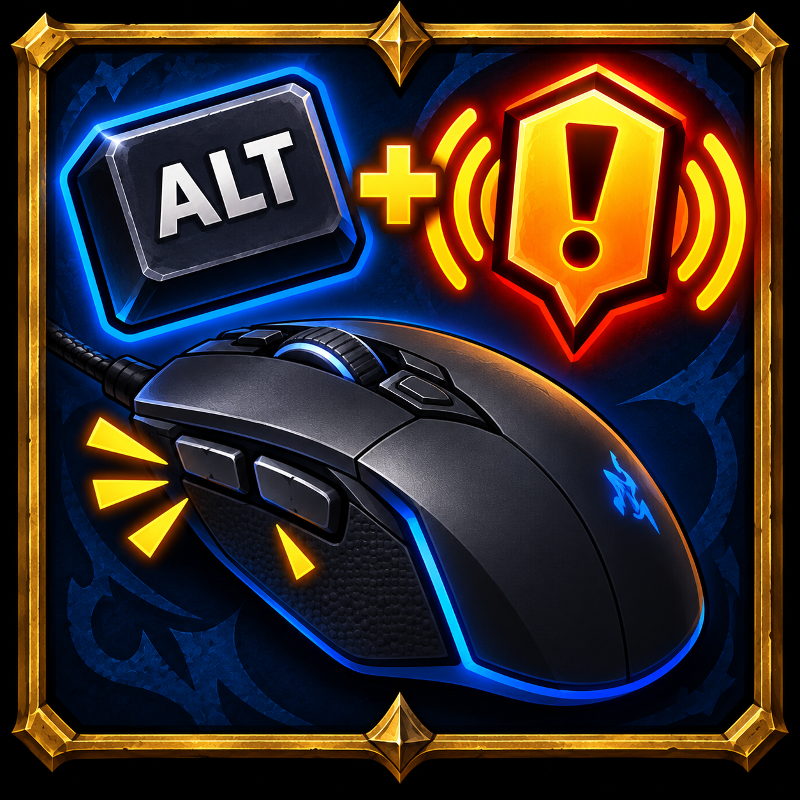

# PingAltClick

> 🤖 **Este addon ha sido íntegramente _vibe-coded_** con [Claude Code](https://claude.com/claude-code). Funciona y se ha probado en el juego, pero tenlo en cuenta.
>
> 🤖 **This addon was entirely _vibe-coded_** with [Claude Code](https://claude.com/claude-code). It works and has been tested in-game, but keep that in mind.

**[Español](#español) · [English](#english)**

---

## Español

Usa el **sistema de pings normal de Blizzard con Alt + clic izquierdo**, sin tener que llevar la mano a la tecla de ping. El modificador y el botón se pueden cambiar: Ctrl + clic izquierdo, Shift + clic derecho, etc. Hecho para **WoW: Forever**.

### Qué hace

| Dónde | Alt + clic rápido | Alt + clic mantenido |
|---|---|---|
| **Mundo** (unidades, objetos, suelo) | Ping contextual | Rueda radial (Atacar, Advertencia, En camino, Ayuda) |
| **Marcos de unidad** (tú, objetivo, foco, grupo, banda) | Ping contextual ("Salud 100%" sobre la barra de vida, unidad sobre el retrato) | Rueda radial *(también en combate, configurable)* |
| **Botones de acción** (Blizzard, Bartender4, Dominos, EllesmereUI) | Ping de la habilidad u objeto | — |

La tabla usa la combinación por defecto (Alt + clic izquierdo); funciona igual con la que elijas.

Es el mismo sistema que la tecla de ping del juego: el resultado es idéntico al de pulsarla con el cursor en el mismo sitio. Tu tecla de ping sigue funcionando.

### Instalación

1. Descarga el addon desde CurseForge o desde las *releases* de GitHub.
2. Copia la carpeta `PingAltClick` en la carpeta `Interface/AddOns/` de tu instalación de WoW: Forever.
3. Reinicia el juego.

No necesita configuración: por defecto es Alt + clic izquierdo.

### Opciones

Escribe **`/pingac`** para abrir la ventana de configuración, o ve a **Opciones → AddOns → PingAltClick**:

- **Modificador:** Alt, Ctrl, Mayús, Ctrl + Alt, Alt + Mayús o Ctrl + Mayús. Tiene que coincidir exactamente: con Alt elegido, Ctrl + Alt + clic queda libre para Clique u otros addons.
- **Botón del ratón:** clic izquierdo o derecho.
- **Igual en combate** *(activada por defecto)*: el clic de ping en los marcos de unidad funciona igual dentro y fuera de combate, con rueda radial incluida. Si la desactivas, en combate solo hace ping contextual sobre los marcos de unidad.

La ventana muestra la combinación actual y avisa si pisa una asignación de teclas que ya tenías (el addon tiene prioridad). Los cambios hechos en combate se aplican al salir.

### Comandos

- `/pingac` — abre la ventana de configuración.
- `/pingac ctrl izq`, `/pingac alt+mayus der`, `/pingac reset` — cambia la combinación desde el chat (acepta también `left`/`right`, `shift`).
- `/pingalt` — diagnóstico. Pon el ratón sobre un botón o marco, escribe el comando y te dice qué elemento recibe el clic, si está enganchado y cómo está configurado el sistema de pings.
- `/pingalt debug` — activa o desactiva una traza del modo seguro en combate (fuera de combate).

### Cómo funciona y limitaciones

- La función que activa la tecla de ping (`C_Ping.TogglePingListener`) está restringida, así que el addon asigna la acción de ping (`TOGGLEPINGLISTENER`) a la combinación elegida (por ejemplo `ALT-BUTTON1`) con un *override binding*.
- Fuerza el modo de ping **"Mantener tecla"** (`pingMode = 0`): pulsación corta = ping contextual, mantener = rueda. También afecta a tu tecla de ping normal.
- Los clics sobre la interfaz no llegan a las asignaciones de teclas:
  - En **botones de acción y marcos de unidad** se envuelve el clic con un fragmento seguro que, con la combinación elegida, ejecuta `/ping` sin objetivo, que hace exactamente lo mismo que la tecla de ping sobre ese elemento. Compatible con **Bartender4**, **Dominos**, **Clique** y **EllesmereUI**: los botones y marcos de otras interfaces se reconocen por sus atributos seguros, no por su nombre.
  - En los **marcos de unidad**, mientras mantienes el modificador se desactivan sus clics, así que el clic cae al mundo y se abre el sistema de ping completo, rueda incluida. Fuera de combate solo se desactivan los clics (no el movimiento del ratón). **En combate** eso está bloqueado, así que con la opción *Igual en combate* un controlador de estado seguro desactiva el ratón del marco por completo mientras el modificador está pulsado (durante ese momento el marco no muestra su tooltip).
- La combinación elegida sobre un botón de acción hace ping en lugar de su acción normal (por ejemplo, Alt + clic ya no hace *self-cast*); modificador + tecla de atajo sigue lanzando la habilidad.
- Con el modificador pulsado, los demás clics sobre un marco de unidad (por ejemplo, abrir su menú) tampoco llegan al marco.

---

## English

Use **Blizzard's regular ping system with Alt + Left Click**, no need to reach for the ping key. The modifier and the button are configurable: Ctrl + Left Click, Shift + Right Click, etc. Made for **WoW: Forever**.

### What it does

| Where | Alt + quick click | Alt + hold click |
|---|---|---|
| **World** (units, objects, ground) | Contextual ping | Radial wheel (Attack, Warning, On My Way, Assist) |
| **Unit frames** (player, target, focus, party, raid) | Contextual ping ("Health 100%" on the health bar, unit on the portrait) | Radial wheel *(in combat too, configurable)* |
| **Action buttons** (Blizzard, Bartender4, Dominos, EllesmereUI) | Spell / item ping | — |

The table uses the default combination (Alt + Left Click); it works the same with whichever you pick.

It's the very same system as the game's ping key: the result is identical to pressing it with the cursor in the same spot. Your ping key keeps working.

### Installation

1. Download from CurseForge or from the GitHub releases.
2. Copy the `PingAltClick` folder into the `Interface/AddOns/` folder of your WoW: Forever install.
3. Restart the game.

No configuration needed: the default is Alt + Left Click.

### Options

Type **`/pingac`** to open the settings window, or go to **Options → AddOns → PingAltClick**:

- **Modifier:** Alt, Ctrl, Shift, Ctrl + Alt, Alt + Shift or Ctrl + Shift. It must match exactly: with Alt selected, Ctrl + Alt + click stays free for Clique or other addons.
- **Mouse button:** left or right click.
- **Same in combat** *(enabled by default)*: the ping click on unit frames works the same in and out of combat, radial wheel included. When disabled, in combat it only sends a contextual ping on unit frames.

The window shows the current combination and warns you if it overrides an existing keybind (the addon takes priority). Changes made in combat are applied when combat ends.

### Commands

- `/pingac` — opens the settings window.
- `/pingac ctrl left`, `/pingac alt+shift right`, `/pingac reset` — change the combination from chat.
- `/pingalt` — diagnostics. Hover a button or frame and run it to see which element receives the click, whether it is hooked, and the ping system settings.
- `/pingalt debug` — toggles a trace of the in-combat secure handler (out of combat).

### How it works & limitations

- The function behind the ping key (`C_Ping.TogglePingListener`) is restricted, so the addon binds the ping action (`TOGGLEPINGLISTENER`) to the chosen combination (e.g. `ALT-BUTTON1`) via an override binding.
- It forces the **"Key Down"** ping mode (`pingMode = 0`): short press = contextual ping, hold = wheel. This also applies to your regular ping key.
- UI clicks don't reach key bindings:
  - On **action buttons and unit frames**, the click is wrapped with a secure snippet that, on the chosen combination, runs a target-less `/ping`, which does exactly what the ping key does on that element. Works with **Bartender4**, **Dominos**, **Clique** and **EllesmereUI**: buttons and frames from other UIs are detected by their secure attributes, not their names.
  - On **unit frames**, while the modifier is held their clicks are disabled, so the click falls through to the world and the full ping system opens, wheel included. Out of combat only clicks are disabled (mouse motion is not). **In combat** that is blocked, so with the *Same in combat* option a secure state driver disables the frame's mouse entirely while the modifier is held (the frame shows no tooltip meanwhile).
- The chosen combination on an action button pings instead of its normal action (e.g. Alt + click no longer self-casts); modifier + keybind still casts.
- While the modifier is held, other clicks on a unit frame (e.g. opening its menu) don't reach the frame either.

---

## Licencia / License

[MIT](LICENSE)
